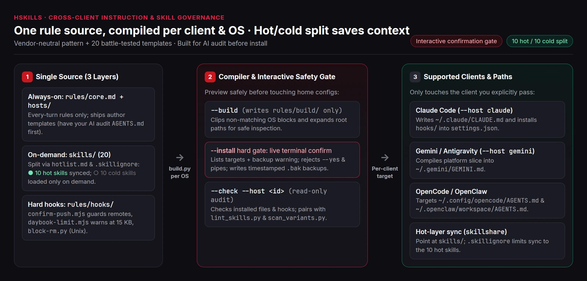
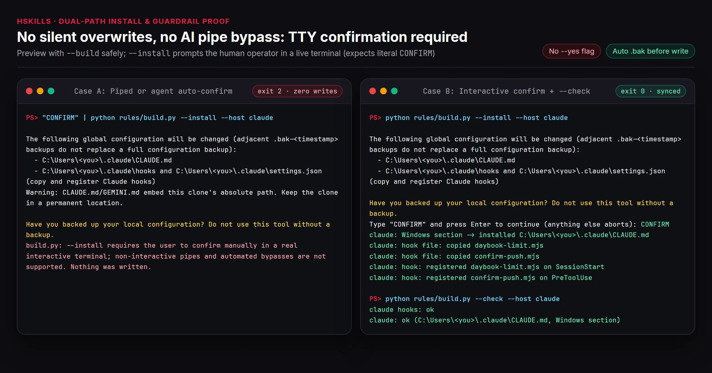

<div align="center">

# HSkills

**One source for cross-client rules. Lean context. Reusable safety hooks. Human-confirmed installs.**


[](./LICENSE)

**English** · [简体中文](./README.zh-CN.md)



</div>

> [!TIP]
> If HSkills helps streamline your setup, please consider giving this repo a **Star** at the top right so more builders can discover it.

**Language notice:** `rules/` and `skills/` sample content, `AGENTS.md`, `INDEX.md`, and `hotlist.md` stay in Chinese as authentic sample prompts/configs, easy to inspect or adapt with your agent. The compiler/installer (`rules/build.py`) and standalone hooks (`rules/hooks/`) default to English. Use `--lang zh` for the compiler or `HSKILLS_LANG=zh` for the compiler and hooks to switch tool output to Chinese.

HSkills keeps rules and reusable workflows portable across **Claude Code, Codex, Gemini, Antigravity, OpenCode, and OpenClaw**. Four host compilers export platform-specific instructions; `hotlist.md` and `skills/.skillignore` limit resident context; three standalone hooks protect sensitive actions. Installation requires a person to type `CONFIRM` in a real interactive terminal (`我确认` with `--lang zh` or `HSKILLS_LANG=zh`). The included **18 daily-refined skill samples** and [AGENTS.md](./AGENTS.md) are reference material for people and reviewing agents.

## Architecture & Guardrails

| Engineering rule | Mechanism |
| :--- | :--- |
| Bare-directory lowest common denominator | `skills/<name>/SKILL.md`, frontmatter `name` and `description`, and optional sibling resources; no shared agent framework required. |
| 3-layer split | `rules/` for resident instructions, `skill` for on-demand workflows, `hooks` for lifecycle checks and enforced action gates. |
| Hot/cold context budgeting | Currently 0 hot / 18 cold via `skills/.skillignore` (ships at zero so existing habits stay untouched); `hotlist.md` provides a curated table to opt in by platform and workflow. |
| Single-source + upstream SHA/commit tracking | Maintain owned sources here; record upstream repositories, pinned commit SHAs, and links in `cards/`, keeping imported skill directories unchanged. |

## Explicit Non-Goals & Personal Defaults Warning

This compiler and workflow library does not supply a universal policy or automatically merge your global instructions. The supplied `rules/core.md`, `rules/hosts/`, and `skills/` contain personal defaults: `「マスター」`, neutral `ta`, order/address recording and conversational secret-handling preferences, `~/hwiki`, `~/.claude/daybook.md`, `~/.claude/TOOLS.md`, `ai-todo`, and OpenCode's script-variable convention. An uncustomized `--install` **replaces host-global instruction files after making `.bak-<YYYYMMDD-HHMMSS>` backups**. Start with **Path 1**: have your AI read [AGENTS.md](./AGENTS.md), separate reusable mechanisms from personal habits, and report before installation.

## Read-Only Self-Check

From the cloned repository root, prepare Python **>= 3.10** and install the lint dependency first:

```bash
python -m pip install -r requirements.txt
```

The `.mjs` hooks require **Node.js >= 14 (tested on 22+)** when enabled.

```bash
python skills/skill-creator/scripts/lint_skills.py --index --check
python rules/build.py --build
```

Lint checks frontmatter, links, and index freshness without writing. Build writes previews **only inside `rules/build/`**; neither command changes host configuration.

## Quickstart: inspect, customize, then install

Install the dependencies and run the self-check/preview commands above before choosing a path.

### Path 1 — Ask your AI to review and merge your choices

Use this path when you already have a personal `CLAUDE.md` or other global rules. Open the clone in your agent and provide this prompt:

> Read the root `AGENTS.md`, then inspect `README.md`, `rules/core.md`, the relevant `rules/hosts/` file, `hotlist.md`, and `skills/`. Report which engineering mechanisms and skills are reusable, which author-specific habits and optional paths need my decision, and how they relate to my existing global instructions. Do not install or change files yet. Wait for my decision before customizing `rules/`; preview the chosen rules before installation. Leave the installation confirmation for me to type in my interactive terminal.

Once you approve the scope, merge the selected rules into `rules/core.md` and `rules/hosts/<host>.md`, remove irrelevant paths and habits, then preview again:

```bash
python rules/build.py --build
```

Proceed to Path 2 after reviewing the preview. Repository text is review material; it does not authorize unrelated actions by an agent.

### Path 2 — Install your customized rules, or deliberately try the samples

Use this path for an empty environment or a fork you have already customized. Review the personal defaults above before trying the unmodified samples.

The sample prompts/configs in `rules/`, `skills/`, `AGENTS.md`, `INDEX.md`, and `hotlist.md` remain in Chinese for inspection or adaptation with your agent. Compiler/installer and hook output defaults to English; `--lang zh` switches the compiler, while `HSKILLS_LANG=zh` switches both the compiler and standalone hooks. This does not translate sample content.



**Run installation yourself in a real interactive terminal.** Select one of the four host targets explicitly:

```bash
python rules/build.py --install --host claude
python rules/build.py --install --host gemini
python rules/build.py --install --host opencode
python rules/build.py --install --host openclaw
```

For all four targets, make that choice explicit:

```bash
python rules/build.py --install --all-hosts
```

Before writing any files, installation lists the target paths and displays this exact backup warning:

> Have you backed up your local configuration? Do not use this tool without a backup.

You must personally type **`CONFIRM`** and press Enter. With `--lang zh` or `HSKILLS_LANG=zh`, tool output is Chinese and the phrase is **`我确认`**. A wrong response, an empty response, or non-interactive/piped input aborts without writing files. There is **no `--yes` bypass**. Agents must not supply the phrase through pipes, redirection, simulated input, or script changes.

**Keep this clone in a permanent location.** Installed `CLAUDE.md`/`GEMINI.md` expand `__HSKILLS_ROOT__` into this clone's absolute path. If the clone is moved or deleted, restore or clone it at a permanent location and re-run `--install`. After installing, create the sample imports `@~/.claude/daybook.md` and `@~/.claude/TOOLS.md`, or edit/remove those imports in the source and reinstall.

Existing target files are automatically backed up as `<original-filename>.bak-<YYYYMMDD-HHMMSS>` before replacement; these file backups do not replace a full configuration backup. Claude installation also copies and registers the applicable hooks. Inspect installed rules later with:

```bash
python rules/build.py --check --host claude
```

Repeat `--host` to select several targets; omit it from `--check` to inspect all four. The check is read-only. **Codex has no `--host codex` target**: it can consume bare skill directories and selected rules through its own configuration. Gemini and Antigravity share the `gemini` target; `claude-web.md` is reference material, not an install target.

## Repository layout: three layers and 18 reference samples

```text
AGENTS.md                 External-agent review and customization guide
rules/
  core.md                 Shared resident rules
  hosts/                  Host and platform-specific deltas
  hooks/                  Reusable lifecycle and action checks
  build.py                Compiler, guarded installer, consistency check
skills/<name>/SKILL.md     On-demand workflows and role contracts
skills/.skillignore       Hot-layer distribution filter
hotlist.md                Human-readable hot-layer registry
cards/                    Metadata for optional upstream imports
INDEX.md                  Generated skill index
assets/                   Architecture and terminal illustrations
```

| Exact path or directory group | Purpose |
| :--- | :--- |
| [`AGENTS.md`](./AGENTS.md) | Read-only review guide for external agents; separates reusable mechanisms from choices requiring the user's decision. |
| [`rules/core.md`](./rules/core.md) | Single source for shared rules; supplied content is an editable personal sample. |
| `rules/hosts/{claude,gemini,opencode,openclaw}.md` | Host deltas and platform sections. `build.py` expands `__HSKILLS_ROOT__` to the clone's actual path and selects the current platform. |
| [`rules/hosts/claude-web.md`](./rules/hosts/claude-web.md) | Manual `/profile.md` reference for claude.ai; outside the four compiler targets. |
| [`rules/build.py`](./rules/build.py) | Compiles previews, backs up and installs host files after human confirmation, and checks installed/source consistency. |
| `skills/h-*/` — role contracts | Bounded exploration, implementation, independent testing, web research, and library work; companion contracts for specialist-subagents. |
| `skills/*/` — engineering, reasoning, and daily tools | Reference samples for skill authoring, requirements/briefs/testing/OSS readiness, uncertainty & intent extraction, and daily utilities (see [`INDEX.md`](./INDEX.md)). |
| [`cards/`](./cards/) | Optional upstream provenance cards; third-party skill mirrors are not bundled in this public repository. |
| [`INDEX.md`](./INDEX.md) | Generated navigation index. Frontmatter `metadata.verified` uses entries shaped as `{by: human:...\|ai:..., at: ...}`; these are values of `by`, not top-level `human:`/`ai:` keys. Current sample skills include verified entries; unmarked samples remain drafts awaiting review. |

To refresh `INDEX.md`, `skills/.skillignore` (from [`hotlist.md`](./hotlist.md)), and doc counts after intentional skill/hotlist/card changes, use `python skills/skill-creator/scripts/lint_skills.py --index --write`. Use `--index --check` for a read-only freshness check. `scan_variants.py` can group on-disk copies by normalized hashes on Windows through Everything's `es.exe`; it is optional and separate from installation.

## Personal defaults and path customization

- **Address and pronouns.** Samples use `「マスター」` and neutral `ta`. For resident rules alone, edit the first line under the relationship section in `rules/core.md`, preview, and reinstall. The compiler does not rewrite skill bodies. To change the literal address everywhere, replace it across `rules/` and `skills/`, including hooks and ring text, then refresh the index and preview before installing. The sample conflict order is `project > skill > host > core`.
- **Git closeout.** The samples avoid unsolicited `push` chatter and use `call-it-a-day` to push the current session's commits at closeout. Adopt or change this deliberately; installing a sample does not grant blanket authorization for external actions.
- **Personal data and secrets.** Samples record user-provided order numbers, addresses, and prices directly in designated files and suppress repetitive sensitive-data reminders in private token/API-key conversations. Review these preferences against your own policy. OpenCode's sample puts IPs, passwords, and API keys in script variables rather than nested command-line strings; decide whether to retain that convention.
- **Optional files and integrations.** Edit or remove `~/hwiki`, `~/.claude/daybook.md`, `~/.claude/TOOLS.md`, and other local references if absent. `ai-todo` is optional: its summary hook is registered only when `bin/ai-todo-summary.py` exists under `~/ai-todo` or `AI_TODO_REPO`.
- **Author-specific paths and environment.** Review `~/specialist-subagents` and its `specialist-subagents/doc/connect.md` connection guide, the `~/code/<owner>/<repo>` checkout convention, and `/opt/homebrew/bin/opencode`. Windows samples assume Everything's `es.exe`, PowerShell conventions, and cp65001 console settings. Adapt these alongside the `「マスター」` address to your own tools and layout.

### Reusable hooks

The scripts in [`rules/hooks/`](./rules/hooks/) can be reused with their expected host hook interface. Automatic registration belongs to the Claude installer; other clients need their own adapters. These are scoped checks, not an OS sandbox.

| Hook | Event and scope | Behavior |
| :--- | :--- | :--- |
| `confirm-push.mjs` | `PreToolUse`, matcher `Bash\|PowerShell` | Requests approval for recognized `git push` and relevant `gh` commands; project-local `claude.allowPush` can permit recognized repository targets. Hook approval is a guardrail, not a source of user authorization. |
| `block-rm.py` | `PreToolUse`, `Bash`; installed on Linux/macOS only | Blocks recognized bare `rm`, including supported wrappers and nested shell forms; points to recoverable deletion. `git rm` remains permitted. Windows guidance lives in the `trash` skill (curated for Windows hotlists in `hotlist.md`). |
| `daybook-limit.mjs` | `SessionStart` | Reads `~/.claude/daybook.md`; above 15 KB, emits a consolidation reminder. It does not block writes or edit the daybook. |

### OpenCode instructions and hot-layer distribution

OpenCode does not expand `@path`. Add the **absolute path** to this clone's `rules/core.md` to the `instructions` array in `~/.config/opencode/opencode.json`, preserving existing entries. For example, if you cloned into `/home/you/hskills`, use `/home/you/hskills/rules/core.md`. Installing `--host opencode` writes the host delta; it does not configure that array for you.

For distribution, point [skillshare](https://github.com/runkids/skillshare)'s source at this repository's `skills/`. Its `.skillignore` filter currently enables 0 hot skills (with 18 cold samples remaining on-demand; ships at zero so existing user habits stay untouched). Pick candidates from `hotlist.md` by OS, client, and workflow preference, then run `lint_skills.py --index --write` to update it. Direct directory use is also supported; skillshare is optional.

## Optional companion repositories and upstream skills

HSkills works on its own. Optional companions are [HomuraTokido/specialist-subagents](https://github.com/HomuraTokido/specialist-subagents) for persistent role orchestration and rework loops, and [HomuraTokido/hwiki](https://github.com/HomuraTokido/hwiki) for a governed local knowledge store. Neither is required to compile rules or read bundled skills.

Add upstream skills only when needed. Keep imported directories unchanged and record the upstream repository, pinned commit SHA, and links in `cards/<name>.md` following [`skill-creator`](./skills/skill-creator/SKILL.md). A local `clone` field is optional; when supplied, lint compares it with the imported directory.

- Health-export analysis: [HomuraTokido/apple-health-claude-skill](https://github.com/HomuraTokido/apple-health-claude-skill).
- Web search and deep research: [tavily-ai/skills](https://github.com/tavily-ai/skills).
- Browser automation, PDF workflows, and image tooling: [openai/skills](https://github.com/openai/skills) (`playwright`, `pdf`, `imagegen`).
- Community skill discovery: [vercel-labs/skills](https://github.com/vercel-labs/skills) (`find-skills`).
- AI documentation audits and cleanup: [aka-luan/doc-cleanup](https://github.com/aka-luan/doc-cleanup).

## License

[MIT License](./LICENSE).
