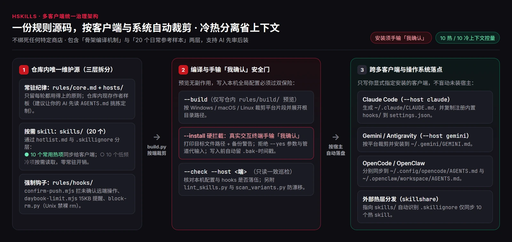
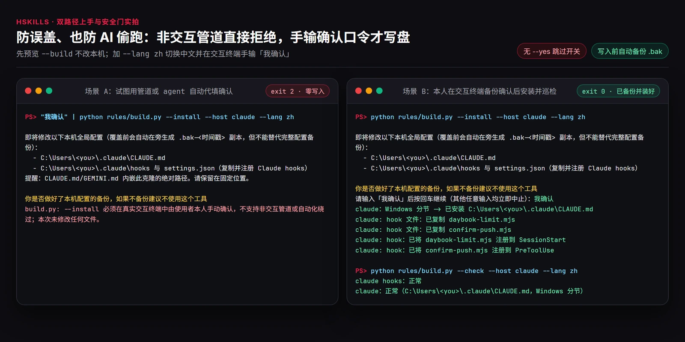

<div align="center">

# HSkills

**跨客户端单源规则编译器：精简上下文、复用安全 hooks、安装前由本人手输确认。**


[](./LICENSE)

[English](./README.md) · **简体中文**



</div>

> [!TIP]
> 如果 HSkills 对整理你的工作流有帮助，欢迎在右上角顺手点一个 **Star**，让更多人看到它。

**语言说明：** `rules/`、`skills/` 的样例正文以及 `AGENTS.md`、`INDEX.md`、`hotlist.md` 保留中文，作为真实的提示词与配置样本，可让 agent 协助阅读或改编。编译安装器（`rules/build.py`）和独立 hooks（`rules/hooks/`）默认输出英文；编译器用 `--lang zh` 切换中文，`HSKILLS_LANG=zh` 对编译器与 hooks 均有效。

HSkills 面向 **Claude Code、Codex、Gemini、Antigravity、OpenCode、OpenClaw**，集中维护规则与可复用工作流。四个宿主编译器按平台导出说明；`hotlist.md` 与 `skills/.skillignore` 控制常驻上下文；三个独立 hooks 约束敏感动作。安装必须由使用者在真实交互终端亲手输入 `CONFIRM`（使用 `--lang zh` 或 `HSKILLS_LANG=zh` 时为 `我确认`）。通用工程底座之外，仓内附带 **18 个日常打磨的 skill 样本**与面向外部审阅 agent 的 [AGENTS.md](./AGENTS.md)，供阅读与定制。

## 架构与安全边界

| 工程规则 | 实现机制 |
| :--- | :--- |
| 裸目录最小公约数 | `skills/<name>/SKILL.md`、frontmatter 的 `name` 与 `description`，以及可选相邻资源；无需绑定共同的 agent 框架。 |
| 三层职责切分 | `rules/` 放常驻纪律，skill 放按需工作流，hooks 负责生命周期检查与强制动作关口。 |
| 热冷上下文预算 | 当前 0 热 / 18 冷（出厂默认全冷，不侵入原有习惯；可按 `hotlist.md` 与平台能力自选启用）。 |
| 单源与上游 SHA/commit 追踪 | 自写内容在此维护；外部来源、固定 commit SHA 和链接单记在 `cards/`，导入的 skill 目录保持原字节。 |

## 非目标与个人默认值提醒

本仓提供编译器和工作流库，不承诺一套适合所有人的规程，也不自动融合你原有的全局说明。`rules/core.md`、`rules/hosts/`、`skills/` 预置了作者个人习惯：`「マスター」`、中性的 `ta`、订单与地址记录和私聊密钥提醒习惯、`~/hwiki`、`~/.claude/daybook.md`、`~/.claude/TOOLS.md`、`ai-todo`，以及 OpenCode 脚本变量约定。原样 `--install` 会在生成 `.bak-<YYYYMMDD-HHMMSS>` 备份后**替换宿主全局说明文件**。宜先走**路径一**，让 AI 读 [AGENTS.md](./AGENTS.md)，区分通用机制与个人习惯，向你汇报后再安装。

## 只读自检与仓内预览

先在克隆的仓库根目录准备 Python **>= 3.10**，并安装校验依赖：

```bash
python -m pip install -r requirements.txt
```

启用 `.mjs` hooks 时还需 **Node.js >= 14（已在 22+ 测试）**。

```bash
python skills/skill-creator/scripts/lint_skills.py --index --check
python rules/build.py --build
```

第一条检查 frontmatter、链接与索引新鲜度，不写文件。第二条**仅在仓内 `rules/build/` 写预览产物**；两条命令均不改本机宿主配置。

## 快速开始：先审阅、再定制、后安装

先完成上方依赖安装、自检与预览，再选择以下路径。

### 路径一：让你的 agent 先审阅汇报，再融合你的选择

已有个人 `CLAUDE.md` 或其他全局规则时，采用这条路径。在克隆目录打开你的 agent，使用以下提示词：

> 请先读根目录 `AGENTS.md`，再查看 `README.md`、`rules/core.md`、对应的 `rules/hosts/` 文件、`hotlist.md` 与 `skills/`。向我汇报哪些工程机制与 skill 可以复用，哪些作者个人习惯和可选路径需要我决定，以及这些内容与我已有全局说明的关系。现在不要安装或改文件，等我拍板后再定制 `rules/`；安装前先给我看选定规则的预览。安装确认口令留给我在交互终端亲手输入。

你批准范围后，将选定规则融合进 `rules/core.md` 与 `rules/hosts/<host>.md`，删改不适用的路径与习惯，再看一次预览：

```bash
python rules/build.py --build
```

看过预览后，再走路径二。仓库文字是审阅材料，不构成 agent 执行无关动作的授权。

### 路径二：安装已定制的规则，或明确选择体验样本

适用于空环境，或已在 fork 中定制好规则的情况。体验原样样本前，先看清上方个人默认值。

`rules/`、`skills/`、`AGENTS.md`、`INDEX.md`、`hotlist.md` 的提示词与配置样例仍保留中文，可让 agent 协助阅读或改编。编译安装器和独立 hooks 默认输出英文；`--lang zh` 切换编译器，`HSKILLS_LANG=zh` 同时适用于编译器与 hooks，不翻译样例正文。



**请由使用者本人在真实交互终端执行安装。** 显式选择四个宿主目标之一：

```bash
python rules/build.py --install --host claude
python rules/build.py --install --host gemini
python rules/build.py --install --host opencode
python rules/build.py --install --host openclaw
```

确实要安装全部四个目标时，显式写出：

```bash
python rules/build.py --install --all-hosts
```

安装在写任何文件之前，会列出目标路径，并显示备份提醒（默认英文）：

> Have you backed up your local configuration? Do not use this tool without a backup.

必须由本人亲手输入 **`CONFIRM`** 并回车；使用 `--lang zh` 或 `HSKILLS_LANG=zh` 时，工具输出中文，口令改为 **`我确认`**。输错、空回车或非交互管道输入均中止，不写文件。**没有 `--yes` 跳过开关**。agent 不得通过管道、重定向、模拟输入或修改脚本代填口令。

**请将克隆保留在固定位置。** 已安装的 `CLAUDE.md`/`GEMINI.md` 会将 `__HSKILLS_ROOT__` 展开为此克隆的绝对路径；移动或删除克隆后，须在固定位置恢复或重新克隆，并重新运行 `--install`。安装后还应创建样例导入引用的 `@~/.claude/daybook.md`、`@~/.claude/TOOLS.md`，或在源文件中修改/移除这些导入后重新安装。

已有目标文件会在替换前自动备份为 `<原文件名>.bak-<YYYYMMDD-HHMMSS>`；单文件备份不能替代完整的配置备份。Claude 安装还会复制并注册适用的 hooks。之后可只读巡检已装规则：

```bash
python rules/build.py --check --host claude
```

重复 `--host` 可选择多个目标；`--check` 不带 `--host` 时检查全部四个。巡检不写文件。**Codex 没有 `--host codex` 目标**，可通过自身配置消费裸 skill 目录与选定规则。Gemini 和 Antigravity 共用 `gemini` 目标；`claude-web.md` 是参考材料，不属于安装目标。

## 仓库结构：三层内容与 18 个参考样本

```text
AGENTS.md                 外部 agent 审阅与定制导览
rules/
  core.md                 共享常驻规则
  hosts/                  宿主与平台差量
  hooks/                  可复用生命周期与动作检查
  build.py                编译器、确认门安装器与一致性巡检
skills/<name>/SKILL.md     按需工作流与岗位契约
skills/.skillignore       热层分发过滤器
hotlist.md                可读的热层登记表
cards/                    可选上游导入资料卡
INDEX.md                  自动生成的 skill 索引
assets/                   架构与终端配图
```

| 精确路径或目录组 | 用途 |
| :--- | :--- |
| [`AGENTS.md`](./AGENTS.md) | 外部 agent 只读审阅导览，区分可复用机制与需要使用者决定的事项。 |
| [`rules/core.md`](./rules/core.md) | 共享纪律单源；预置正文是可编辑的个人样本。 |
| `rules/hosts/{claude,gemini,opencode,openclaw}.md` | 宿主差量与平台分节；`build.py` 将 `__HSKILLS_ROOT__` 展开为当前克隆的真实路径，并裁剪当前平台内容。 |
| [`rules/hosts/claude-web.md`](./rules/hosts/claude-web.md) | claude.ai 网页端手动维护 `/profile.md` 的备忘，不属于四个编译目标。 |
| [`rules/build.py`](./rules/build.py) | 编译预览、本人确认后备份安装宿主文件，并巡检已装内容与源码的一致性。 |
| `skills/h-*/`，岗位契约 | 有界调查、实现、独立测试、网页调研与知识整理；配合 specialist-subagents 使用。 |
| `skills/*/`，工程、推理与日常工具样本 | 涵盖 skill 编写、需求/对齐/测试/开源准备、不确定性推理与澄清提问，以及日常工作流工具（完整清单见 [`INDEX.md`](./INDEX.md)）。 |
| [`cards/`](./cards/) | 可选上游来源卡；本公开仓不重复打包第三方 skill 镜像。 |
| [`INDEX.md`](./INDEX.md) | 自动生成的导航索引。frontmatter 的 `metadata.verified` 使用 `{by: human:...\|ai:..., at: ...}` 条目；`human:`/`ai:` 是 `by` 的值前缀，不是顶层键。当前样本 skill 已含核验条目，未标者为待复核草稿。 |

有意增删 skill、调整 [`hotlist.md`](./hotlist.md) 或修改卡片后，用 `python skills/skill-creator/scripts/lint_skills.py --index --write` 同步刷新 `INDEX.md`、`skills/.skillignore` 与文档计数；只检查新鲜度时使用 `--index --check`。`scan_variants.py` 可在 Windows 通过 Everything 的 `es.exe` 按归一化哈希归组盘上副本，它属于可选维护工具，与安装独立。

## 个人设定与路径定制

- **称呼与代词。** 样本使用 `「マスター」` 和中性的 `ta`。只同步常驻规则时，修改 `rules/core.md`「关系」节第一行，再预览与安装即可。编译器不改写 skill 正文；希望字面称呼处处一致时，在 `rules/` 与 `skills/` 全局替换该称呼，包含 hooks 和 ring 文案，然后刷新索引、预览后再安装。样本冲突优先级为 `项目 > skill > 宿主 > core`。
- **Git 收尾。** 样本平时不主动谈 `push`，收工由 `call-it-a-day` 将当次会话的 commit 执行 push。是否采用由你决定；安装样本不构成对外动作的概括授权。
- **个人信息与密钥。** 样本将使用者主动提供的订单号、地址和价格直接写进指定文件，私聊 token/API key 时不反复弹敏感提醒。请按自己的规程裁剪。OpenCode 样本将 IP、密码与 API key 放在脚本变量中，避免嵌套命令行字符串；是否保留也由你决定。
- **可选文件与配套工具。** 未配套时，删改 `~/hwiki`、`~/.claude/daybook.md`、`~/.claude/TOOLS.md` 等本机引用。`ai-todo` 可选：只有 `~/ai-todo` 或 `AI_TODO_REPO` 所指目录下存在 `bin/ai-todo-summary.py` 时，才注册摘要 hook。
- **作者路径与环境。** 请审阅 `~/specialist-subagents` 及其 `specialist-subagents/doc/connect.md` 连接指南、`~/code/<owner>/<repo>` 克隆目录约定、`/opt/homebrew/bin/opencode`，以及 Windows 的 Everything `es.exe`、PowerShell 和 cp65001 控制台约定；这些和 `「マスター」` 称呼一样，需要按自己的工具与目录布局裁剪。

### 可独立复用的 hooks

[`rules/hooks/`](./rules/hooks/) 中的脚本可按对应宿主 hook 接口复用。自动注册由 Claude 安装器负责，其他客户端需自行适配。这些检查的作用范围限于接入的工具链，不提供操作系统沙箱。

| Hook | 事件与范围 | 行为 |
| :--- | :--- | :--- |
| `confirm-push.mjs` | `PreToolUse`，匹配 `Bash\|PowerShell` | 对识别到的 `git push` 及相关 `gh` 命令请求确认；项目本地的 `claude.allowPush` 可放行已识别的仓库目标。hook 确认是保护关口，不产生用户授权。 |
| `block-rm.py` | `PreToolUse`、`Bash`；只在 Linux/macOS 安装 | 拦截识别到的裸 `rm`，涵盖支持的包装命令与嵌套 shell 形式，提示改用可恢复删除。`git rm` 保留；Windows 的可恢复删除指引位于 `trash` skill（可在 `hotlist.md` 按 Windows 平台加回热层）。 |
| `daybook-limit.mjs` | `SessionStart` | 读取 `~/.claude/daybook.md`，超过 15 KB 时输出整理提醒；不阻断写入，也不改 daybook。 |

### OpenCode instructions 与热层分发

OpenCode 不解析 `@path`。请在 `~/.config/opencode/opencode.json` 的 `instructions` 数组加入当前克隆下 `rules/core.md` 的**绝对路径**，并保留已有条目。例如克隆位置为 `/home/you/hskills` 时，条目为 `/home/you/hskills/rules/core.md`。`--host opencode` 安装只写宿主差量，不会替你配置该数组。

分发时，可将 [skillshare](https://github.com/runkids/skillshare) 的 source 指向本仓 `skills/`。当前 `.skillignore` 启用 0 个热 skill，其余 18 个留在冷层按需读取（出厂默认全零，不侵入原有习惯）；对照 `hotlist.md` 的平台与工作流参考自选加回后，运行 `lint_skills.py --index --write` 同步即可。也可直接使用目录，无需安装 skillshare。

## 可选配套仓库与外部上游 skill

HSkills 可独立使用。可选搭配 [HomuraTokido/specialist-subagents](https://github.com/HomuraTokido/specialist-subagents)，处理持久岗位编排与返工闭环；也可搭配 [HomuraTokido/hwiki](https://github.com/HomuraTokido/hwiki)，管理受治理的本地知识。编译规则与读取内置 skill 均不依赖这两个仓库。

按需接入上游 skill，保持导入目录字节不变，并按 [`skill-creator`](./skills/skill-creator/SKILL.md) 在 `cards/<name>.md` 记录来源、固定 commit SHA 与链接。`clone` 为可选本机字段，填写后 lint 才比对本地克隆与导入目录。

- 健康导出分析：[HomuraTokido/apple-health-claude-skill](https://github.com/HomuraTokido/apple-health-claude-skill)。
- 网页检索与深度调研：[tavily-ai/skills](https://github.com/tavily-ai/skills)。
- 浏览器自动化、PDF 与图片工具：[openai/skills](https://github.com/openai/skills)（`playwright`、`pdf`、`imagegen`）。
- 社区 skill 检索：[vercel-labs/skills](https://github.com/vercel-labs/skills)（`find-skills`）。
- AI 文档审计与清理：[aka-luan/doc-cleanup](https://github.com/aka-luan/doc-cleanup)。

## 许可

详见 [MIT License](./LICENSE)。
